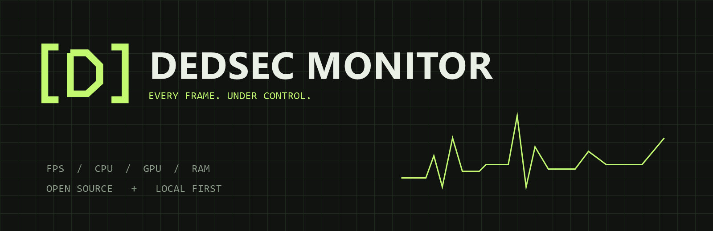
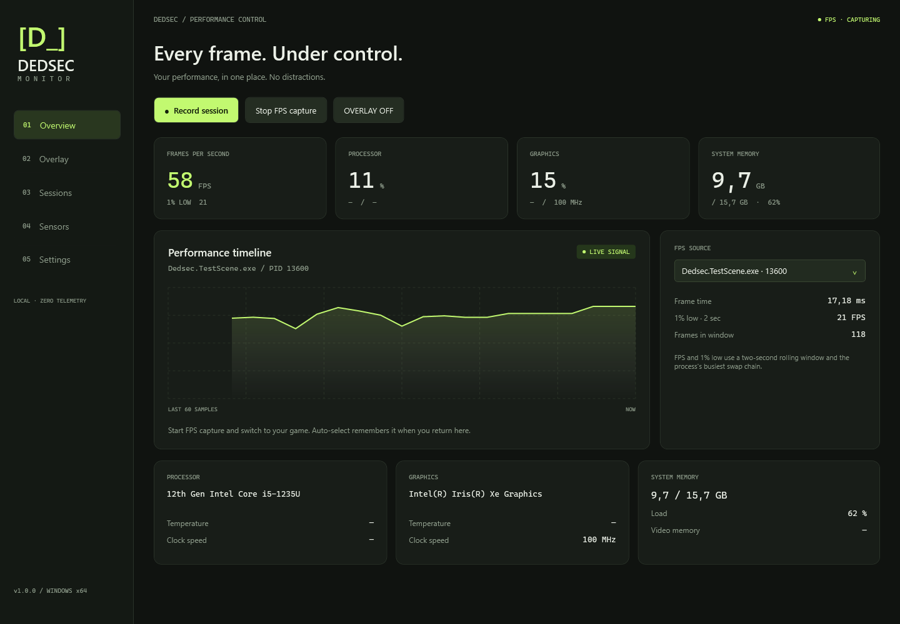

# Every frame. Under control.

**Dedsec Monitor** is a native Windows performance monitor with a dark, acid-green interface, a click-through game overlay, live hardware readings and CSV session recording. Russian and English are included.

[Download the latest release](https://github.com/Dedseckms/Dedsec-Monitor/releases/latest) · [Русский README](README.md) · [Report an issue](https://github.com/Dedseckms/Dedsec-Monitor/issues)



## Get started

1. Install the **Setup x64 EXE**, or extract the entire **Portable x64 ZIP** and run `Dedsec.Monitor.exe`. The .NET runtime and PresentMon are included.
2. If frame capture or temperatures are unavailable, use **Settings → Restart with full access** and accept the Windows administrator prompt.
3. Launch a game in windowed or borderless mode. Auto-select remembers the foreground graphics process; you can also choose it manually in Overview.
4. Enable the overlay. **Ctrl + Shift + O** toggles it; **Ctrl + Shift + R** starts/stops a recording.

CPU/GPU load, temperature and clocks, RAM, VRAM and available power sensors are collected through LibreHardwareMonitor. FPS comes from PresentMon's ETW capture, without injecting DLLs into the game. An unavailable reading is shown as `—`.

## Compatibility and measurements

- Windows 10 build 19041+ or Windows 11, x64. No Linux or ARM64 build in this release.
- The overlay is a separate transparent Windows window, intended for borderless/windowed games. Exclusive fullscreen, driver behavior and anti-cheat policies may restrict it. No promise of support for every game.
- FPS is `1000 / mean frame time` in a rolling two-second window; 1% low is the reciprocal of the average slowest 1% of frame times. The busiest swap chain is selected. These are application Present rates, not display refresh rates.
- Sessions contain aggregated measurements at the configured 0.5–3 second polling interval, not every frame. Session average/minimum FPS summarize these measurements, not a per-frame benchmark.
- Hardware sensor availability depends on the device, drivers and permissions. Some low-level CPU sensors need PawnIO; its official signed installer is bundled and can be launched from Settings, with an explicit Windows permission prompt. See [technical documentation](docs/TECHNICAL.md).
- The initial binaries are unsigned. Verify downloads with the release's `SHA256SUMS.txt`.

Screenshots show the real application and real sensors. `Dedsec.TestScene.exe` is a bounded rendering workload used to verify capture, not a game benchmark.

## Local first

No account, ads, cloud analytics or application network requests. Settings, logs and recordings stay in `%LOCALAPPDATA%\Dedsec\Monitor`. Uninstall preserves this folder. Closing the window defaults to the system tray; use **Exit** in its menu to stop the app.

## Build

On Windows, install .NET 10 SDK, PowerShell 7 and Inno Setup 6.7.1+:

```powershell
./scripts/build.ps1 -Installer
dotnet format Dedsec.Monitor.slnx --verify-no-changes
```

The build script fetches a pinned, SHA-256-verified PresentMon executable, runs tests, then produces a self-contained app, Portable ZIP and themed installer in `artifacts/`. GitHub Actions runs the same build; pushing a `v*` tag creates a release.

## License

GPL-3.0-or-later. [Third-party licenses and sources](THIRD-PARTY-NOTICES.md). This is an independent project, unaffiliated with Ubisoft, Intel, Microsoft or hardware manufacturers.
