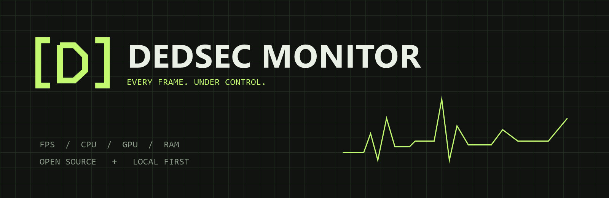
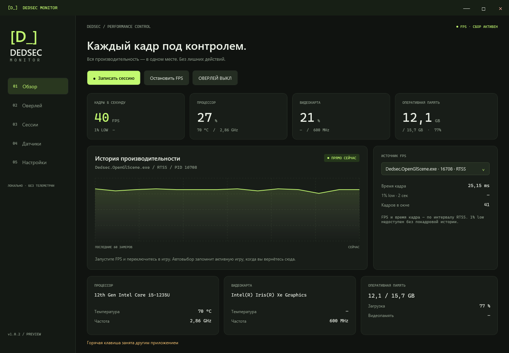
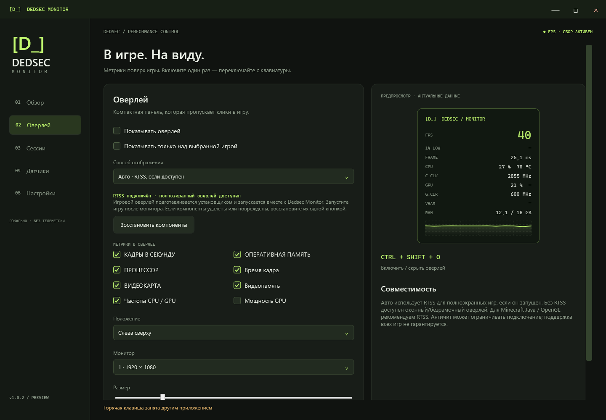
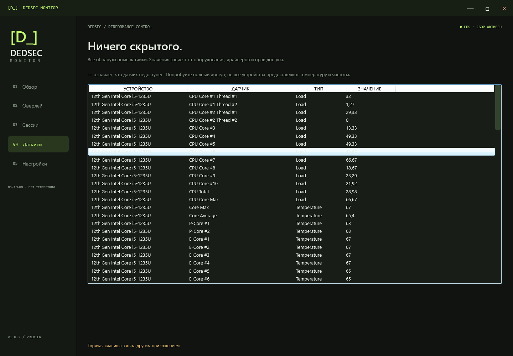
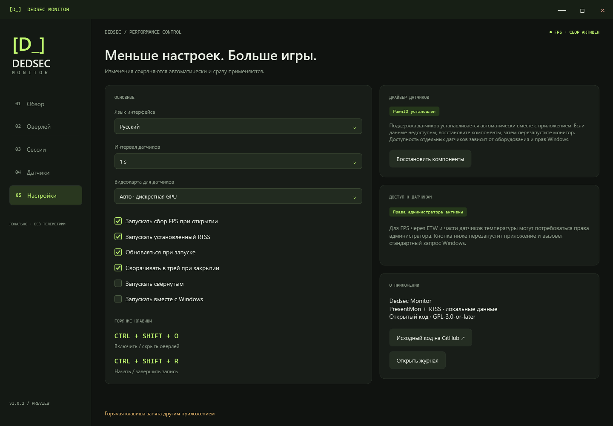
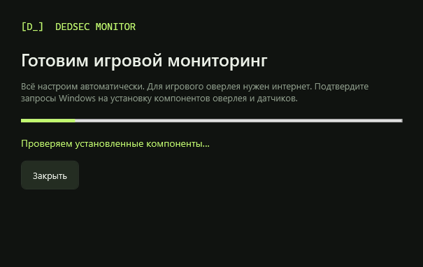

<p align="center"></p>

> **1.0.2-preview — локальная тестовая сборка.** Публикация релиза приостановлена до проверки владельцем. Установщик: `artifacts/Dedsec-Monitor-1.0.2-preview-Setup-x64.exe`. Автоматическая публикация в CI отключена.

<p align="center">
  <a href="docs/VALIDATION.md"></a>
  
  <a href="LICENSE"></a>
</p>

<h1 align="center">Знай свою систему.</h1>
<p align="center">FPS, процессор, видеокарта и память. Живые графики, игровой оверлей и запись сессий.<br>В одном приложении. Без аккаунта, облака и отправки показаний.</p>
<p align="center"><a href="README.en.md">English</a> · <a href="#быстрый-старт">Быстрый старт</a> · <a href="#совместимость">Совместимость</a> · <a href="https://github.com/Dedseckms/Dedsec-Monitor/issues">Сообщить об ошибке</a></p>



## Что внутри

| В игре | На рабочем столе |
| --- | --- |
| FPS, время кадра и 1% low | График последних 60 замеров |
| Загрузка, температура и частоты CPU / GPU | Полный список доступных датчиков |
| Оперативная память и VRAM | Выбор GPU и источника FPS |
| Оверлей с пропуском кликов в игру | Запись CSV и история завершённых сессий |
| Горячие клавиши без переключения окон | Трей, автозапуск и русский / английский интерфейс |

**Настройка за минуту.** Датчики определяются автоматически. Выберите угол экрана, размер и нужные метрики — остальные изменения сохраняются сразу. Все компоненты включены в установщик, отдельная установка .NET и PresentMon не нужна.

## Быстрый старт

1. Для локальной проверки откройте `artifacts/Dedsec-Monitor-1.0.2-preview-Setup-x64.exe`. Публичный релиз появится после одобрения владельцем.
2. Установите и запустите **Dedsec Monitor**. Для варианта без установки распакуйте **весь** Portable ZIP и откройте `Dedsec.Monitor.exe`.
3. Если FPS или температура недоступны, откройте **Настройки → Перезапустить с полным доступом**. Windows запросит права администратора. Программа может работать и с обычными правами, с ограниченным набором показаний.
4. Запустите игру в оконном или безрамочном режиме и переключитесь в неё. Автовыбор запомнит процесс игры. Источник FPS также можно выбрать вручную на странице обзора.
5. На странице **Оверлей** включите панель. Нажимайте **Ctrl + Shift + O**, чтобы скрывать и показывать её во время игры.

| Клавиша | Действие |
| --- | --- |
| `Ctrl + Shift + O` | Показать / скрыть оверлей |
| `Ctrl + Shift + R` | Начать / закончить запись сессии |

Закрытие окна по умолчанию оставляет программу в трее. Для полного завершения выберите **Выйти** в меню значка Dedsec Monitor.

## Твой оверлей



Четыре угла экрана, выбор монитора, масштаб и прозрачность. Нужны только FPS и GPU? Отключите остальные строки. Режим «только над выбранной игрой» скрывает оверлей после переключения на рабочий стол.

## Ничего скрытого

<table>
<tr>
<td width="50%"></td>
<td width="50%"></td>
</tr>
</table>

Если устройство не отдаёт показания, вместо числа отображается `—`. Программа не подставляет случайные значения. На скриншотах используется собранное приложение и реальные показания компьютера; источник FPS `Dedsec.OpenGlScene.exe` — контрольная графическая сцена для проверки захвата, **не игровой бенчмарк**.

## Совместимость

- **Система:** Windows 10 2004 (сборка 19041) или новее, Windows 11; x64. Linux и ARM64 в этом релизе не поддерживаются.
- **FPS:** [PresentMon 2.3.1](https://github.com/GameTechDev/PresentMon/tree/v2.3.1) читает события Windows ETW. В режиме PresentMon внедрение DLL не используется. Поддержка зависит от графического API, драйвера, доступности ETW и правил античита; работа в каждой игре не гарантируется.
- **Оконный backend:** отдельное прозрачное окно Windows поверх игры. Работает в оконном и безрамочном режиме. В эксклюзивном полноэкранном режиме его видимость не гарантируется; используйте «без рамки». Ограничения показа оверлея не означают, что запись FPS тоже недоступна.
- **Датчики:** [LibreHardwareMonitor 0.9.6](https://github.com/LibreHardwareMonitor/LibreHardwareMonitor/tree/v0.9.6). Набор датчиков зависит от оборудования и прав. Поддержку низкоуровневых датчиков PawnIO установщик подготавливает автоматически. Подробности — в [руководстве](docs/TECHNICAL.md).
- **Античит:** программа не обходит защиту и не обещает совместимости со всеми защищёнными играми. Следуйте правилам конкретной игры.
- **Подпись:** первая сборка не подписана сертификатом издателя. Скачивайте её из этого репозитория; контрольные суммы находятся в `SHA256SUMS.txt` в релизе.

### Как считаются FPS и 1% low

FPS — обратное среднему времени между `Present()` в скользящем окне **2 секунды**. Если процесс использует несколько swap chain, выбирается цепочка с наибольшим количеством кадров. 1% low — `1000 / среднее время самого медленного 1% кадров` того же окна. Это краткосрочная метрика, а не 1% low за всю игровую сессию. После двух секунд без новых событий значения очищаются.

CSV записывает **агрегированные замеры** с интервалом 0,5–3 секунды. Средний и минимальный FPS в отчёте сессии рассчитаны по этим замерам; это не покадровый бенчмарк. Частота CPU — средняя доступных частот ядер; память отображается в двоичных гигабайтах (GiB, в интерфейсе — GB).

## Данные остаются у тебя

```text
%LOCALAPPDATA%\Dedsec\Monitor\
├── settings.json        настройки
├── monitor.log          локальный журнал (до 1 МБ + предыдущий)
└── Sessions\
    ├── Dedsec-….csv     замеры сессии
    └── Dedsec-….json    итоговый отчёт
```

Аккаунтов, рекламы и облачной аналитики нет. При включённом автообновлении программа обращается к GitHub за опубликованной стабильной версией и её файлами; показатели оборудования не отправляются. Записи содержат имя процесса и показатели оборудования. При удалении программы настройки и записи сохраняются.

## Fullscreen, Minecraft и обновления

В preview добавлены **два способа оверлея**: отдельное окно для оконного/безрамочного режима и подключение к **RTSS** для отрисовки внутри игры. Режим «Авто» выбирает доступный RTSS. Для Minecraft Java используется FPS из RTSS, если он доступен; PresentMon остаётся источником для других совместимых игр. В интерфейсе указан фактический источник.

**Одна установка — без ручного скачивания компонентов.** В конце установки Dedsec Monitor сам проверит и подготовит игровой оверлей RTSS и драйвер датчиков PawnIO. Нужны интернет и подтверждение запросов Windows. При необходимости установщик предложит перезагрузку. RTSS получается непосредственно с официального зеркала Guru3D и проверяется по закреплённой SHA-256; его бинарники не перепубликуются в нашем репозитории. Уже установленные компоненты используются повторно. Их лицензии остаются в силе: [RTSS / Guru3D](https://www.guru3d.com/download/rtss-rivatuner-statistics-server-download/), [PawnIO](https://github.com/namazso/PawnIO).

В Portable-сборке такая же подготовка запускается при первом старте, если компоненты отсутствуют. При сбое доступна кнопка **«Восстановить компоненты»**: искать установщики и выбирать пути не нужно. Запускайте игру после Dedsec Monitor; RTSS запускается автоматически. Ограничения античита остаются в силе.



Показания RTSS и его FPS проверены на настоящей OpenGL-сцене; подтверждена отрисовка текста в её framebuffer. Это не проверка Minecraft или конкретного эксклюзивного режима. В источнике RTSS 1% low не подставляется: без покадровой истории отображается `—`.

При запуске включённое автообновление ищет только **опубликованный стабильный релиз**. Черновики и prerelease исключены. ZIP проверяется по SHA-256, распаковывается с проверкой путей, затем отдельный updater заменяет только файлы приложения. При неудачном запуске новая версия откатывается. Запись сессии откладывает обновление до следующего запуска. Отсутствие сети или опубликованного релиза не мешает открытию приложения.

## Сборка из исходников

Нужны Windows x64, [.NET 10 SDK](https://dotnet.microsoft.com/download/dotnet/10.0), PowerShell 7 и [Inno Setup 6.7.1+](https://jrsoftware.org/isdl.php) для установщика.

```powershell
git clone https://github.com/Dedseckms/Dedsec-Monitor.git
cd Dedsec-Monitor
./scripts/build.ps1 -Installer
```

Скрипт скачивает закреплённую версию PresentMon с GitHub Intel, проверяет SHA-256, выполняет тесты и создаёт автономную сборку, Portable ZIP и установщик в `artifacts/`.

```powershell
dotnet test tests/Dedsec.Tests -c Release
dotnet format Dedsec.Monitor.slnx --verify-no-changes
dotnet run --project src/Dedsec.Monitor
```

Для запуска через `dotnet run` сначала выполните `./scripts/fetch-presentmon.ps1`. Скриншоты и диагностика создаются через `./scripts/screenshots.ps1`; процедура использует изолированную временную папку настроек и реальные датчики. Архитектура и проверка графического захвата описаны в [docs/TECHNICAL.md](docs/TECHNICAL.md).

## Лицензия и благодарности

[GPL-3.0-or-later](LICENSE). Библиотеки и компоненты распространяются со своими лицензиями — см. [THIRD-PARTY-NOTICES.md](THIRD-PARTY-NOTICES.md).

Спасибо авторам **PresentMon**, **LibreHardwareMonitor** и **.NET**. Dedsec Monitor — независимый проект, не связанный с Ubisoft или производителями оборудования.
