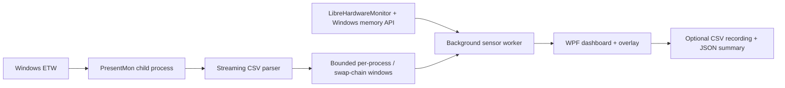

# Architecture and validation

## Preview 1.0.1 changes

The draggable custom caption uses WPF `WindowChrome`, explicit minimize/maximize/close controls, and an initial size constrained to the screen work area. This avoids placing the native title bar outside the usable desktop on scaled displays.

`RtssService` implements the RTSS shared-memory protocol from the official 7.3.7 SDK, independently; the SDK and server binaries are not redistributed. It discovers the installed executable through configuration/registry, reads validated bounded app entries, and uses only its own OSD slot, reserving slot zero for primary clients. The `dwBusy` bit is acquired/released with `Interlocked` on one bounded mapped-memory int. Those two tiny C# unsafe methods access the named statistics mapping only, never game memory. Actual FPS is read from `(1000 * frames) / (time1 - time0)` with stale-data checks. No synthetic per-frame history or 1% low is created from aggregate RTSS samples.

The renderer backend is automatic RTSS when connected, explicit RTSS, or the existing desktop window. Minecraft's Java process prefers RTSS readings when available. Game-specific protection can still reject the RTSS hook. The OpenGL test workload has demonstrated visible OSD pixels in its own framebuffer; it does not establish compatibility with Minecraft or every exclusive fullscreen game.

`UpdateService` checks only the public repository's stable published latest-release API. Draft/prerelease/older versions and foreign download hosts are rejected. Verified ZIPs and a manifest-listed payload are staged below the local Updates directory. The separately bundled self-contained updater waits for the old process, preserves unrelated installation files, backs up replaced files, launches the replacement and waits for a startup acknowledgment. Failure rolls back and restarts the previous version with update checking skipped. Recording defers application until the next launch. Settings/recordings remain outside the installation. Automatic release publication is disabled pending user approval.

## Components

| Path | Responsibility |
| --- | --- |
| `src/Dedsec.Core` | Header-aware CSV parsing, bounded frame windows, settings and session persistence; no GUI dependencies |
| `src/Dedsec.Monitor` | .NET 10 WPF application, hardware worker, PresentMon child process, native hotkeys, tray and overlay |
| `tests/Dedsec.Tests` | Deterministic tests for parsing, metrics, stale data, storage and recording |
| `tests/Dedsec.TestScene` | Separate, bounded WPF render workload for capture verification; not distributed with the app |
| `installer` | Inno Setup per-user installer and uninstall registration |
| `scripts` | Asset generation, verified dependency download, build and screenshots |

## Data flow



All hardware operations happen on a background worker. Windows physical memory and CPU-time APIs provide memory and fallback CPU utilization. Hardware readings are never synthesized. Auto-selection follows the foreground process only if it has emitted graphics events; the last detected process remains selected when returning to Dedsec Monitor. Manual targets are session-scoped, avoiding PID reuse across application restarts.

Frame windows use a maximum of 256 `(PID, swap chain)` pairs and 8,192 samples per pair, expiring samples after two seconds. Pruning is throttled to avoid a full dictionary walk for every rendered frame. FPS uses application Present intervals; dropped/hidden presents are not filtered. PresentMon v1 output's `msBetweenPresents` and v2's `MsBetweenPresents`/`FrameTime` are handled by case-insensitive header lookup. Zero, non-finite and over-one-second intervals are rejected.

The app launches only its bundled `tools/PresentMon.exe`, with shell execution disabled and explicit argument tokens. Each capture uses a process-specific ETW session name. Stopping the app terminates that named session before cleaning up its own child process; it does not stop unrelated PresentMon sessions. No raw unbounded frame CSV is written by the capture service.

## Hardware and drivers

LibreHardwareMonitor 0.9.6 is pinned. Some sensors need administrator access and the [PawnIO driver](https://github.com/namazso/PawnIO), as documented by [LibreHardwareMonitor's source](https://github.com/LibreHardwareMonitor/LibreHardwareMonitor/tree/v0.9.6). GPU APIs and Windows memory APIs can remain available without low-level CPU access. The official signed PawnIO 2.2.0 installer is bundled, with SHA-256 and Authenticode verified at build time. The application launches it only when the user clicks Install sensor support, with the normal Windows permission prompt. Dedsec Monitor does not install kernel drivers automatically or change Windows protection settings. If CPU temperature or clocks remain unavailable with elevated rights, use the bundled official installer in Settings, then restart the app; hardware support still varies.

The program reads sensors only. It does not change fan curves, voltages, power limits, frequencies or game files.

## Overlay

The overlay is a WPF transparent topmost tool window using `WS_EX_TRANSPARENT` and `WS_EX_NOACTIVATE`. It does not consume mouse clicks or activate itself. It is positioned in one of four corners of a selected screen's work area. The window is not a graphics API hook; exclusive fullscreen and protected composition are outside its guarantees. Multi-monitor placement should also be checked on mixed-DPI systems before declaring them supported without caveats.

## Build and test

```powershell
./scripts/fetch-presentmon.ps1
dotnet build Dedsec.Monitor.slnx -c Release
dotnet test tests/Dedsec.Tests -c Release
dotnet format Dedsec.Monitor.slnx --verify-no-changes
./scripts/build.ps1 -Installer
```

For real ETW capture verification, build the separate test workload, launch it and target its PID:

```powershell
dotnet build tests/Dedsec.TestScene -c Release
$scene = Start-Process tests/Dedsec.TestScene/bin/Release/net10.0-windows/Dedsec.TestScene.exe -PassThru
./scripts/screenshots.ps1 -TargetProcessId $scene.Id
```

The workload renders a continuously animated scene for 55 seconds. It exercises Windows Present events, not game compatibility or gaming performance. Screenshot runs use isolated temporary settings, render the actual WPF visual tree and write diagnostics beside the screenshots. They do not capture unrelated desktop content. Inspect `diagnostics.json` for sensor count, actual captured FPS, source PID, capture errors and hotkey registration. Keep machine-specific diagnostic JSON out of release screenshots.

Before releasing, run the installer silently into a disposable directory, launch that installed copy, and run its generated uninstaller. UI screenshots should be regenerated after UI changes. Real protected games and exclusive fullscreen require separate manual verification; passing the render test does not establish compatibility with them.
